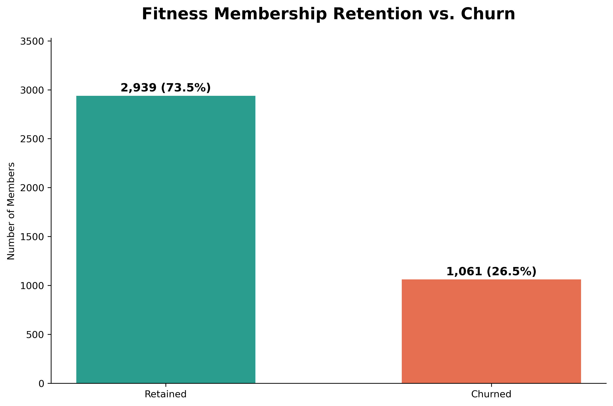
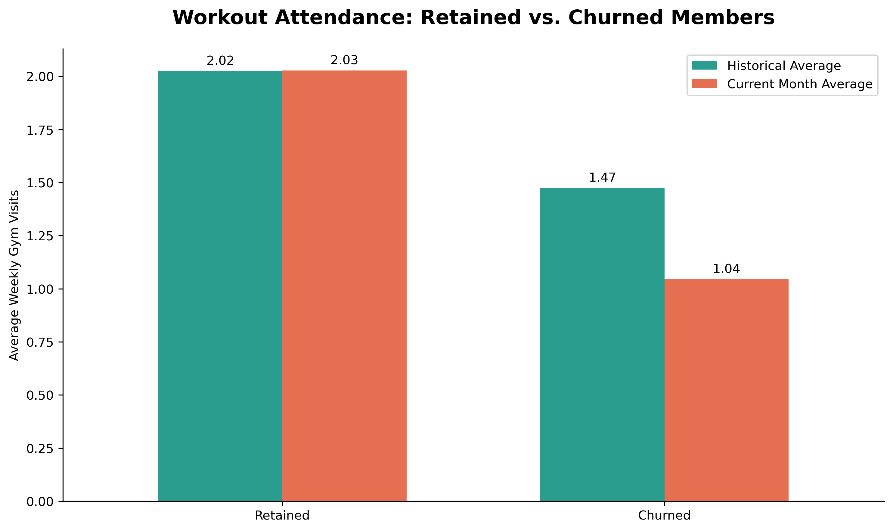
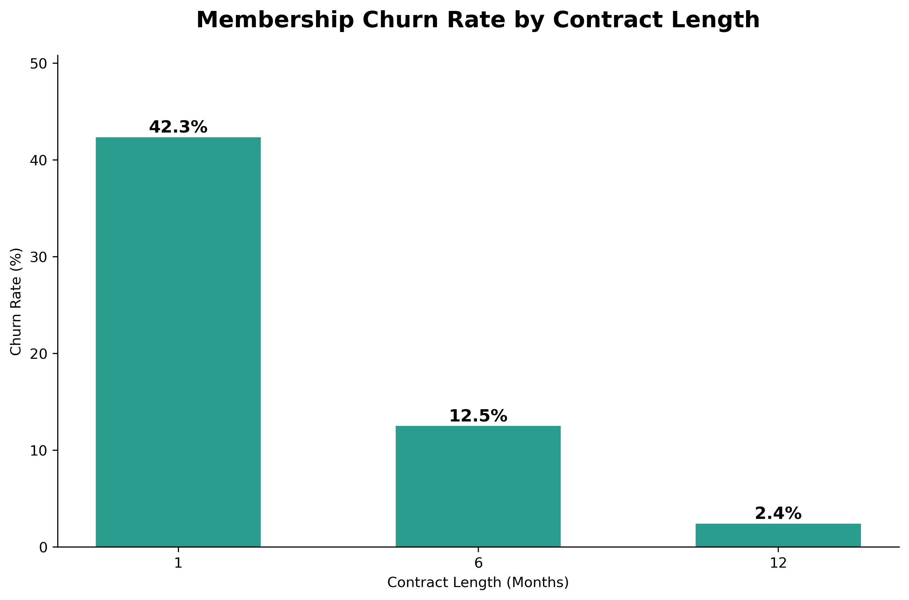
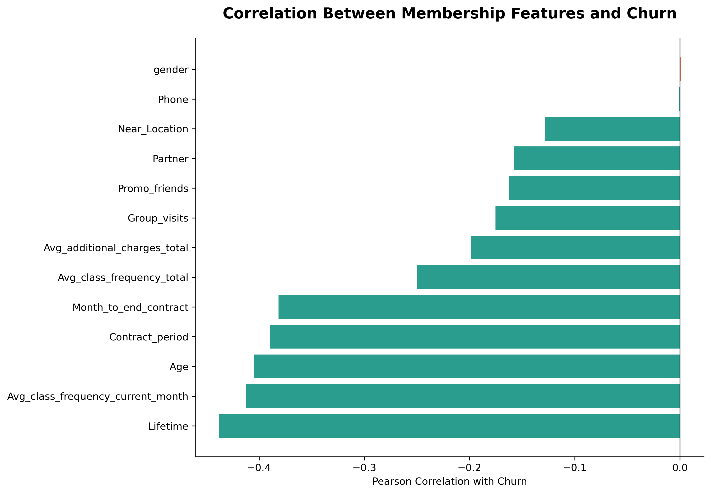
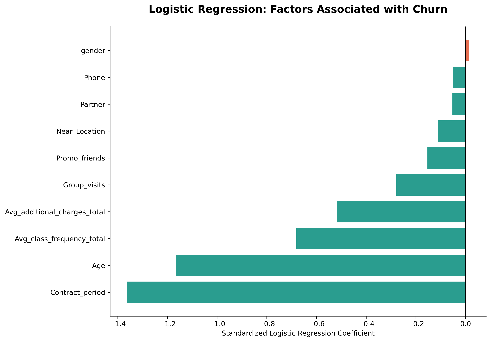
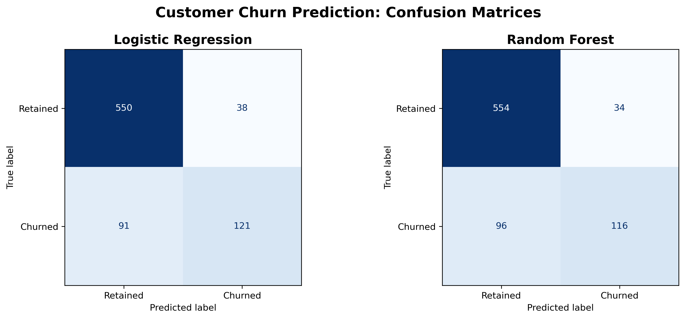
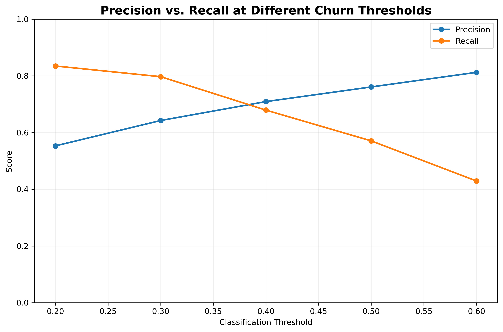
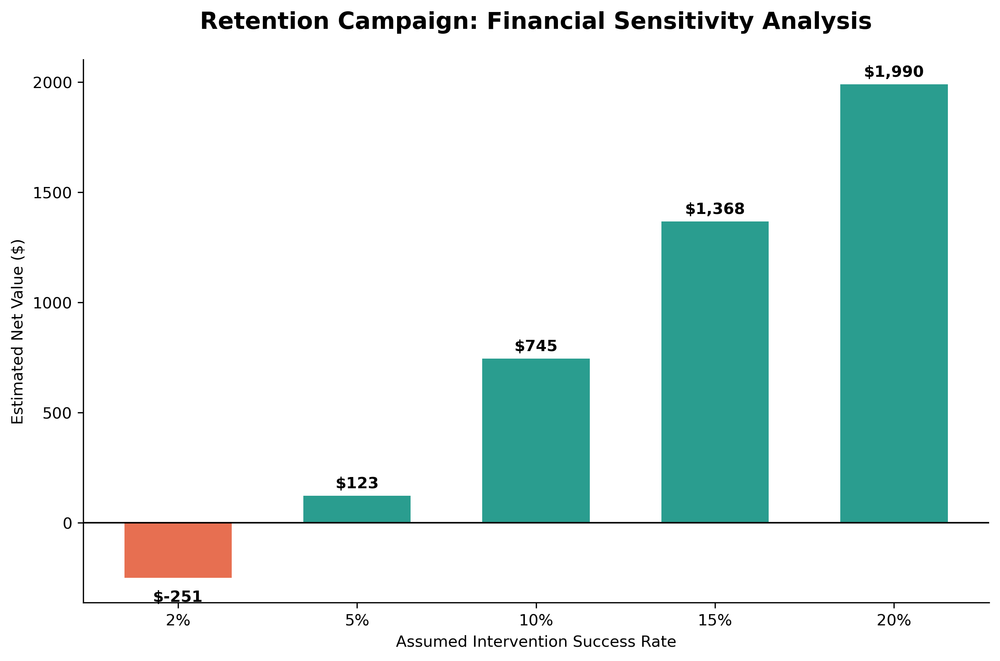

# Fitness Subscription Retention & Churn Prediction
## Project Overview
This project analyzes gym membership data to identify factors associated with customer cancellations and explore how predictive analytics can improve customer retention strategies.
Using Python and machine learning, I examined membership behavior, workout engagement, contract length, and customer churn across 4,000 gym members.
The project combines data analysis, predictive modeling, and hypothetical financial simulations to translate analytical findings into actionable business recommendations.
## Research Question
Can customer engagement data and machine learning help fitness subscription businesses identify customers at risk of cancellation and prioritize retention efforts?
## Tools & Technologies
- Python
- Pandas and NumPy
- Matplotlib and Seaborn
- Scikit-learn
- Logistic Regression
- Random Forest
- Jupyter Notebook
## Key Findings
### Membership Retention
- Total members: 4,000
- Retention rate: 73.5%
- Churn rate: 26.5%
### Workout Engagement
- Retained members averaged 2.03 weekly visits during the current month.
- Churned members averaged 1.04 weekly visits.
### Contract Length
- 1-month contracts: 42.3% churn
- 6-month contracts: 12.5% churn
- 12-month contracts: 2.4% churn
## Machine Learning Results
| Metric | Logistic Regression | Random Forest |
|---|---|---|
| Accuracy | 83.9% | 83.8% |
| Precision | 76.1% | 77.3% |
| Recall | 57.1% | 54.7% |
| F1 Score | 0.652 | 0.641 |
| ROC AUC | 0.893 | 0.888 |
Logistic regression provided slightly stronger overall performance.
## Retention Campaign Simulation
A retrospective simulation identified 100 high-risk customers from an 800-customer test set.
- 83 of the targeted customers actually churned.
- Targeting precision: 83%
- Churn coverage: 39.2%
- Targeting lift: 3.13x
## Hypothetical Financial Impact
Using illustrative campaign assumptions:
- Campaign cost: $500
- Expected additional revenue: $1,245
- Estimated net value: $745
- Estimated ROI: 149%
- Break-even intervention success rate: 4.02%
These results are hypothetical and do not represent observed campaign performance
## Business Recommendations
1. Identify members with declining workout attendance.
2. Develop engagement strategies for short-term contract members.
3. Prioritize high-risk customers for retention outreach.
4. Test retention interventions before implementing them at scale.
## Limitations
The findings are based on observational data and do not establish causal relationships. Predictive results are retrospective, and the financial simulation relies on hypothetical assumptions.
## Project Files
- `retention_analysis.ipynb` - Full Python analysis
- `data/` - Membership dataset
- `figures/` - Data visualizations
- `requirements.txt` - Python dependencies
## Author
Cameron Boardman
Sports Business | Data Analytics | Fitness Technology
## Project Visualizations
### 1. Membership Retention Overview

### 2. Workout Attendance and Churn

### 3. Churn by Contract Length

### 4. Factors Associated with Churn

### 5. Logistic Regression Feature Coefficients

### 6. Model Confusion Matrices

### 7. Precision vs. Recall Thresholds

### 8. Retention Campaign Financial Analysis
